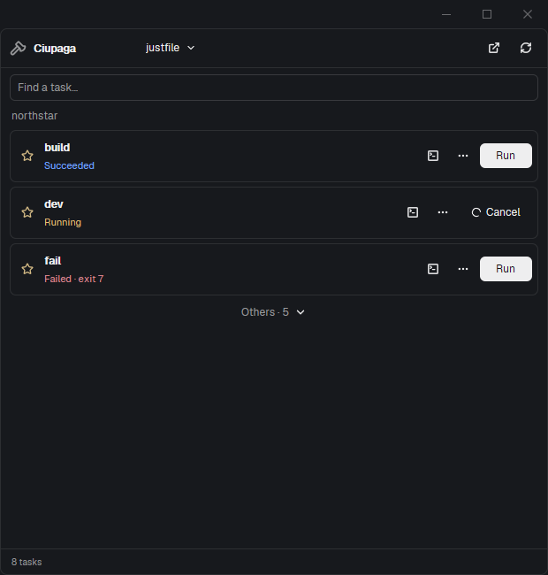

# Ciupaga

Run your project's tasks from Herdr. Open a compact task picker, star the
commands you use most, and follow each run through to success, failure or
cancellation. Keep the picker in a sidebar, a tab or a pane, and open an
interactive console only when you need it.



Ciupaga uses Herdr's native `gpui-base` components and theme colors, with
Lucide icons. It brings no custom window layout, web view or theme. The
same mod works on Windows, macOS and Linux; a task still needs its runner
and any programs used by that task on the project machine.

## Install

Requires Herdr App **0.1.12+** and a compatible herdr-core (`hc`). Node 22+
is needed only for the installer, packaging and tests, not by the mod.

```sh
git clone https://github.com/rgonek/Ciupaga.git
cd Ciupaga
node scripts/install.mjs
herdr-app check ~/.config/herdr-app/mods/ciupaga
herdr-app do mod.open --name ciupaga
```

On Windows, the check path is `$HOME/.config/herdr-app/mods/ciupaga` in
PowerShell. Alternatively copy just `mods/ciupaga/` into your Herdr home's
`mods/` directory. Do not overwrite an existing mod with that name.
The installer respects `HERDR_APP_HOME` or `--home <folder>`, refuses
existing folders, and permits `--update` only for its own installations.
An update replaces Ciupaga's shipped files, so preserve local edits first.

Ciupaga reads task files in the focused terminal's folder (or the active
space's folder when there is no terminal). If none are present, it checks
the Git repository root. It invokes
Just, Task and Mise to list tasks, and starts the selected task through
herdr-core. Listing can evaluate project configuration, including runner
hooks. Ciupaga itself makes no network requests; your runners and tasks
may do so. It does not install runners, trust Mise configs or change task files.

## Task sources

| Source | Discovery | Arguments |
| --- | --- | --- |
| `justfile`, `Justfile`, `.justfile` | Native JSON dump, including modules | Declared positional parameters, defaults, named options, flag checkboxes and simple alternative patterns |
| `GNUmakefile`, `makefile`, `Makefile` | Explicit targets and `.PHONY`; `##` descriptions | Literal extra arguments, e.g. `MODE=release` |
| `Taskfile.yml` / `.yaml`, lowercase names and `.dist` variants | `task --list-all --json` | Extra arguments passed as `CLI_ARGS` after `--` |
| `mise.toml`, `.mise.toml`, `.config/mise.toml` | Effective local list from Mise | Extra arguments; Mise handles its own usage schema |
| `package.json` | `scripts`, including direct child folders in Git repositories | Declared npm/pnpm/Yarn/Bun manager; npm gets its `--` separator |
| `composer.json` | `scripts` | Passed to `composer run-script` |
| `deno.json` | `tasks` | Passed to `deno task` |

The header shows a source picker when several sources exist and the file
name when there is only one. Each source reports its own parse or missing
runner error. Other sources remain usable. Reopening shows the cached list
immediately. Sources are read when there is no cached list, and afterward
only through manual Refresh. There is no periodic filesystem scan or
runner enumeration. Concurrent views share the same pending read; cached
metadata for up to twelve projects survives reopening and app restarts.
Refresh after changing task definitions, imports, lockfiles or installed tools.
Running-task status and cancellation continue to update automatically.

In Git repositories Ciupaga also finds `package.json` one folder below
the current folder, such as `frontend/package.json`. The selector keeps
that relative path and runs the script from the manifest's own folder.
The bounded Git lookup runs on initial discovery and manual Refresh,
in parallel with native runner enumeration. Generated/dependency folders
such as `node_modules`, `bin`, `obj` and `dist` are excluded. This does not
recursively search arbitrary directory trees or ignored package manifests.

Make discovery deliberately does not evaluate the Makefile: included
files, generated targets, target variables and pattern rules are not
expanded. Mise merges config layers and file tasks into one source, as its
runner does. A project with only Mise file tasks and no recognized config
file is not detected yet. JSONC Deno configs, deeper recursive workspace discovery,
Rake, Invoke and arbitrary custom runner definitions are not supported yet.

Package manager selection uses `packageManager`, then `pnpm-lock.yaml`,
`yarn.lock` or `bun.lock`, otherwise npm. The selected manager must already
be available on the machine; Ciupaga does not invoke Corepack automatically.

## Using Ciupaga

- Click **Run** to start a task in the background. Required declared
  parameters open the argument form first. Click the ellipsis or task name
  to edit optional parameters and extra arguments.
- Arguments are literal tokens: quote values containing spaces, for example
  `--name "Ada Lovelace"`. Backslashes stay literal, including Windows paths;
  double a matching quote inside a quoted token to include it. Pipes,
  redirections and shell expansions are not evaluated by the argument field.
- Star a task to keep it at the top. Once any existing task is starred,
  unstarred tasks move under **Others**. Unstar everything to show the whole
  list again. Search also finds tasks inside Others. Stars and argument
  values are shared between views and saved per machine, project and source.
  Windows path spelling and slash variants share the same preferences and runs.
- Just positional parameters whose literal default is `true` or `false`
  are shown as checkboxes, as are explicitly declared no-value flags.
  Positional checkboxes pass the literal `true`/`false` argument to Just.
  Earlier omitted parameters retain their declared literal defaults.
- Feedback distinguishes **Starting**, **Running**, **Succeeded**,
  **Failed** with the runner's exit code, **Cancelled**, and an unavailable
  exit code. **Cancel** ends that task's terminal and children through core.
- The terminal icon opens one placement menu: **new tab**, **beside**,
  **above** or **below**. If already shown, focus it or hide it while keeping
  the process running. Closing a native terminal tab/pane normally ends its
  task; use **Hide console** to keep it running.
- Finished tasks open an ordinary native terminal in a tab, beside, above
  or below. It prints up to 10,000 retained history lines using `hc read`,
  then leaves the normal shell available. Herdr cannot reattach a finished
  terminal; the original task is never restarted to show its output.
  Existing consoles are focused rather than duplicated. There is no custom
  output editor or Refresh button. Output requires core to retain the original.
- The header's external-link menu opens Ciupaga in a **sidebar**, **new tab**,
  **beside** or **below**. Tab/pane views stay attached to their source project.
  A layout sidebar follows the selected space. With no sidebar slot, Sidebar
  opens an ordinary mod pane beside the focused terminal.

Sidebar copies have a theme-colored frame; tab and pane copies stay flat
inside their host layout. In tabs and panes, the title/presentation header
is omitted; the source selector or filename and Refresh sit beside search.
Cancel uses a native animated Lucide spinner.

Task execution outlives closing the picker. If a picker disappears during
startup, the next Ciupaga copy recovers the labeled run from core. Pending
cancellation is reconciled by a live Ciupaga copy; keep a launcher/sidebar
copy in the layout if cancellation during popup teardown must be immediate.

## Fit it into your layout

Put a native launcher block wherever your personal layout has room. Its
popup anchors below the clicked button:

```json
{"type":"block","size":{"px":106},"content":{"mod":"ciupaga","props":{"role":"button"}}}
```

To add a sidebar, place this block in your existing panel or panel stack:

```json
{"id":"my-task-panel","type":"block","content":{"mod":"ciupaga","props":{"role":"sidebar"}}}
```

Ciupaga finds the block by its mod/role, opens hidden ancestors and selects
the containing stack. IDs are yours to choose. If several sidebar copies
exist, the first in the layout tree is used. The installer does not alter
your layout, tab bar, key bindings or other mods. Clone shipped layouts
before changing their structure.

Optional key bindings use Herdr's existing `keys.json` format:

```json
{"global":{"ctrl-alt-j":"mod.open:ciupaga"},"mod:ciupaga":{"ctrl-r":"ciupaga.refresh"}}
```

Merge them with your current bindings rather than replacing the file.
The mod also accepts `ciupaga.tab`, `.sidebar`, `.beside`, `.below`,
`.sources`, `.views`, and task commands such as
`herdr-app do ciupaga.run:build`, `.cancel:build`, `.star:build`,
`.details:build`, `.console:build`, `.console-right:build`,
`.console-up:build`, `.console-down:build`, `.hide-console:build` and
`.source:package.json`.
These target shown copies and their selected source; use them with a single
intended view visible. A task name containing `:` is retained in full.

## Development and packaging

```sh
npm test
herdr-app check mods/ciupaga
node scripts/verify-core.mjs
npm run package
```

`verify-core.mjs` explicitly starts the harmless example tasks and cleans
up its own test terminals. `examples/northstar/` includes Make, Just, Task,
Mise and package-script examples; `dev` runs until cancelled and `fail`
intentionally fails. CI is configured for Windows, macOS and Linux. The
public package in `dist/ciupaga/` includes only the mod, installer, license,
recipe, documentation and preview. It does not include local state or tests.

Runner references: [Just parameters](https://just.systems/man/en/recipe-parameters.html),
[Task CLI and JSON format](https://taskfile.dev/docs/reference/cli),
[Mise task discovery](https://mise.jdx.dev/tasks/task-discovery.html).
