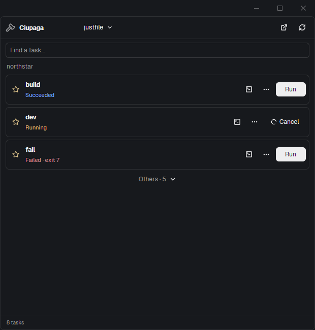

# Ciupaga — project tasks inside Herdr

Ciupaga puts your project's everyday commands one click away. Pick a task
file, star your regular tasks, and run, watch or cancel them without
leaving Herdr. Open the picker as a popover, keep it in a sidebar or move
it into a tab or pane; open a full console only when you need one.

## What you see

A native, theme-aware task list. The popover is 520 logical pixels wide
and 500 high; pane and sidebar copies fill their assigned block. A 44px
header has a Lucide axe, the Ciupaga name, a source picker (or plain file
name for a single source), presentation menu and refresh. A native search
input and project name follow; the full project path is a tooltip.

Rows have a star toggle, task name, description or current outcome,
console-placement menu when a run exists, an ellipsis for arguments, and
a Run/Cancel button. They are at least 57px high. Stars use the theme's
yellow; running, success and failure use working/done/error theme colors,
with plain status text as well. Unstarred tasks collapse into Others once
there is an existing starred task. A footer shows task count and package
manager, plus a source-specific discovery limitation when relevant.

Expanded rows show the description, startup error, declared Just
parameters and an optional extra-arguments input. Declared boolean flags
and literal positional defaults `true`/`false` are native checkboxes.
Positional checkboxes pass literal values and preserve earlier defaults.
Simple `a|b` Just patterns become choices. Other
parameters are native text inputs; defaults are hints and are left to the
runner when omitted. A short command preview identifies the invocation.

Use a neutral theme color for the axe, a square-terminal console icon,
and Lucide app-window/columns-2/rows-2/panel-right icons in placement menus.
Cancel and Cancelling show a native rotating loader-circle, never a JS
animation timer. Add an 8px rounded theme-border frame only to sidebar
copies; keep pane and tab copies flat inside their host's own frame.
In pane/tab copies omit the title, axe and presentation header entirely.
Keep the source selector or filename and Refresh in the search row instead.

No custom fonts, hard-coded color palette, window frame or replacement
tab bar. Use native `gpui-base` controls and bundled Lucide SVGs, tinted
with the current Herdr theme. Keep flexible labels truncated in narrow
panes; task-list scrolling stays between the fixed header and footer.

## How it behaves

Discover task sources in the focused terminal's folder, falling back to
the space folder and then the Git repository root when no sources exist. Use explicit
context props pinning tab and pane copies to a project. Offer Make, Just,
Task, Mise, package scripts, Composer and Deno as described in README.
Hydrate cached metadata immediately on opening/context change. Share one
in-flight request between copies. Probe source contents every ten seconds;
reuse unchanged runner metadata, including missing-runner errors, for up
to sixty seconds. Manual Refresh forces enumeration. Imported-file and
lockfile-only changes are refreshed at the sixty-second boundary. Do not
serialize raw task source text into persistent shared state.
Keep errors local to a source; do not replace another usable list with a
missing-runner error. Discard stale asynchronous discovery results after
the context changes.

With no stars, show everything. With stars, show those tasks first and
hide Others until expanded. Search reveals matching unstarred tasks too.
Store stars and argument forms under machine/project/source identity;
changing the selected task file must not share favorites accidentally.

Run starts a detached, labeled herdr-core terminal. Required parameters
open their form first. Parse extra arguments into literal tokens, with
single/double quote grouping and doubled matching quotes; never interpret
the field as a shell command. Preserve backslashes. Native runners retain
their own execution and dependency semantics.

Show Starting, Running, Cancelling, Succeeded, Failed with exit code,
Cancelled, or Finished with unavailable exit code. Reserve starts before
awaiting core so rapid clicks in separate copies cannot duplicate them.
Reconcile pending cancellation by the unique run label. Fetch the final
terminal snapshot when a completed background terminal disappears from
live data. Closing a picker leaves the task running and the next copy
can recover a launch whose response was interrupted.

For a live task, the console menu opens a new tab, right pane, upper pane
or lower pane. Focus an existing console rather than duplicating it.
Hide via terminal parking, preserving the process.
For a finished task, open a normal native console running `hc read` with
up to 10,000 history lines. The user's shell remains available afterward.
Support tab/right/up/down and track the viewer's backing pane so another
click focuses it instead of duplicating it. Never rerun the original task
to show output. No custom editor or output Refresh control.

The presentation menu opens Ciupaga in a tab, beside, below or in the
layout's sidebar. Find sidebar blocks by `content.mod` and `props.role`,
not reserved node IDs. Reveal hidden ancestors and choose containing
stack children. Without a sidebar slot, use a right mod pane. A native
launcher role opens a popup below its button bounds captured on mouse-down.
Escape and keyboard focus use Herdr's native overlay/control behavior.

## Built from

One `mods/ciupaga/` folder, `place: none`, focusable, with an overlay
declaration. `main.js` owns per-copy lifecycle and the shared run/form/
preference stores. `ui.js` renders all roles: popup, button, sidebar/pane,
and finished output. `model.js` contains pure metadata normalization,
argument tokenization, manager selection, grouping and argv construction.
`discovery.js` reads recognized sources and enumerates native runners.
`cache.js` coalesces requests, retains source fingerprints in memory and
coordinates run checks, cancellations and console openings across copies.
`runtime.js` resolves contexts, run states, reservations and layout routes.

Use `View`, `div`, `svg`, `Button`, `Toggle`, `Checkbox`, `Popover`,
`InputState`/`Input`. Create focus handles and
input state in init or handlers, never during render. Reuse theme
colors; no HTML/CSS/Node APIs in runtime code.

Herdr APIs: `focused`, `spaces`, `panes`, `terminals`, `window`, `theme`,
`props`, `shared`/`setShared`, `readTextFile`, `exec`, `hc`, `nextCommand`,
`openOverlay`/`closeOverlay`, `notify`, and `run`. Core operations are
`run --bg --no-parent --no-notify`, labeled task/run IDs, `get`, `ls` with
an exact run label and `read`. Layout operations are
`layout.show`, `layout.select`, `tab.new`, `tab.rename`, `tab.select`,
`pane.split`, `pane.focus`, `pane.swap`, `terminal.keep`, `terminal.park`
and `terminal.kill`.

Launch argv directly on Unix. On Windows use stock Windows PowerShell
with separately single-quoted literal argv so npm/pnpm/Yarn command shims
work without cmd.exe metacharacter expansion. Detect a remote machine's
platform on that machine rather than assuming it matches the client.

`scripts/install.mjs` installs only this mod, respects `HERDR_APP_HOME`
and `--home`, refuses unknown existing folders and requires an ownership
marker for `--update`. It does not change layouts or key bindings.
`scripts/package.mjs` stages an allowlisted public folder. Include the
Lucide license and an actual privacy-clean native screenshot as preview.

## Watch out

Require Herdr App 0.1.12+ and a compatible core. Native runners must be
installed on the project machine; Node is a development/installer tool,
not a mod dependency. Do not auto-install tools or trust Mise configs.
Native task enumeration may evaluate configuration and hooks.

Make parsing lists explicit targets and phony names only. Mise exposes
one effective configuration, not independently runnable config layers.
Find child `package.json` files one level down with bounded `git ls-files`
pathspecs, including tracked and nonignored untracked files. Exclude
dependency/generated folders; cache the lookup for sixty seconds and run
it in parallel with root metadata enumeration. Show the relative manifest
path in the selector, detect its own lockfile, and launch in its own cwd.
Direct-folder and parent-folder views of the same manifest share identity.
Unknown parameter schemas use the argument field. Deno JSONC, deeper recursive
workspace scanning and arbitrary custom runners are not implemented.
Show actual limitations instead of silently claiming complete discovery.

`cx` belongs to its callback; never retain one. Async work must check its
generation before publishing discovery. Terminal keeping is asynchronous:
wait for its actual pane before naming/focusing it. Core keeps normal
coded exits final, so no extra keep-off command is needed when opening.
Upper consoles use a lower split followed by a native pane swap. Finished
output uses a native console too. Output is core retention, not a permanent log file.

A cancellation requested during popup teardown needs another live copy
or the next opening to reconcile it. Preserve this pending intent in
shared state. A launcher in the layout is a long-lived copy. Do not kill
tasks when closing the mod view. Never alter another mod to make this
one installable; expose launcher/sidebar blocks for personal layouts.

## Done when

- `npm test` passes and `herdr-app check mods/ciupaga` passes.
- Multiple source files produce a real source picker; one source shows
  its name. Missing runners display useful errors without blocking other sources.
- Star/unstar and Others behave consistently between popup and pane copies.
- A successful task retains success after leaving live terminal data;
  intentional failure retains its exit code; Cancel stops a long-running task.
- Live consoles can open in tab/right/up/down, accept input, and hide
  without ending the task. Finished output can be selected and copied.
- A task with required Just arguments opens a native form. Flags and
  finite simple choices use native controls; extra values stay literal.
- A custom sidebar ID works; a layout with no sidebar can open a mod pane.
- Inspect real async UI states in Herdr, beyond the initial render check.
- The public package contains only allowlisted files, notices and a
  screenshot without personal data. Other mods and user layouts remain untouched.
